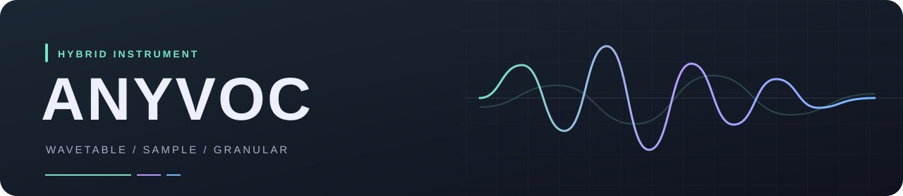
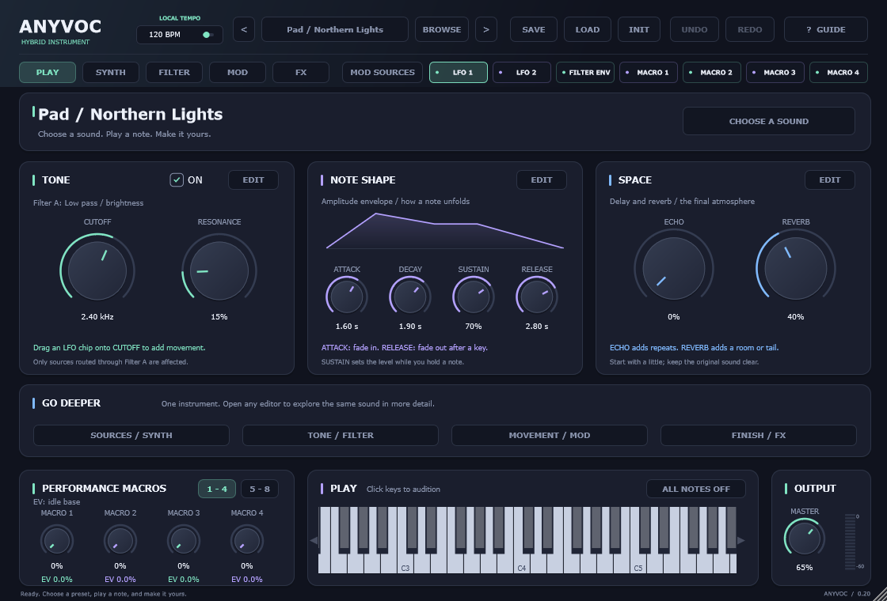
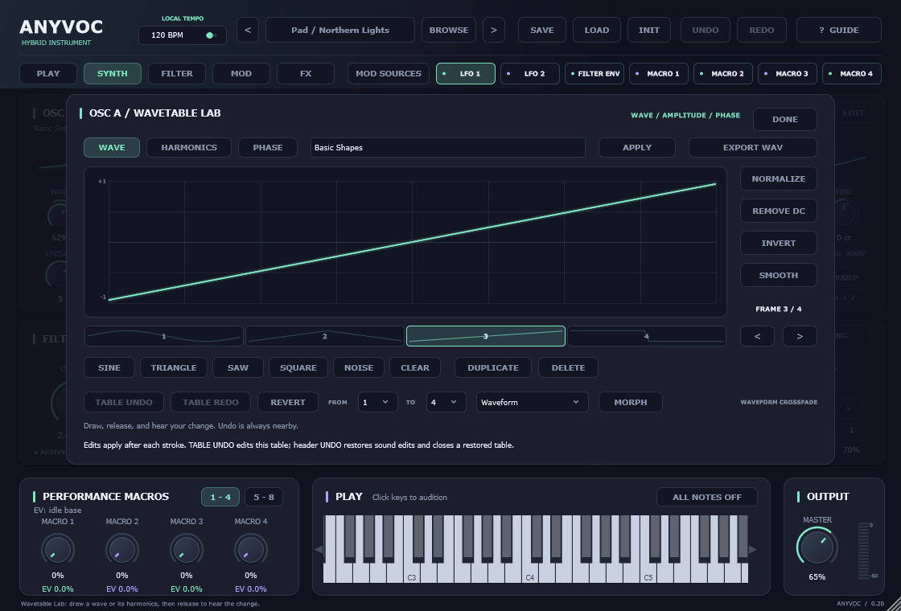
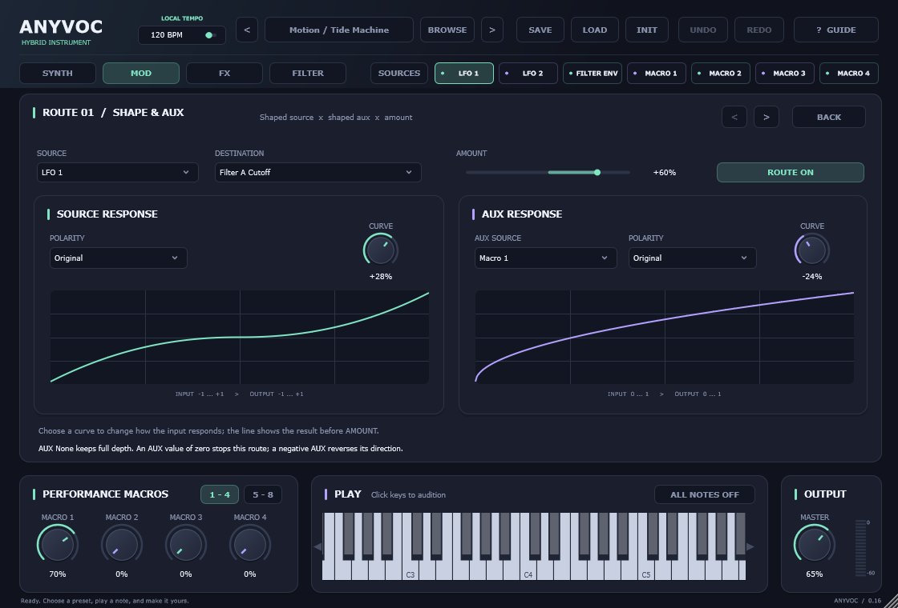

<div align="center">
  

  <p><strong>从第一个音符，到自己的声音。</strong><br>面向 Windows 的原创混合合成器，提供独立程序与 VST3 乐器插件。</p>

  <p>
    <a href="https://github.com/Bad0RANG3/Anyvoc/actions/workflows/windows.yml"></a>
    <a href="docs/VALIDATION-0.20.4.md"></a>
    
    <a href="LICENSE"></a>
  </p>

  <p><a href="docs/快速开始.txt"><strong>新手开始</strong></a> · <a href="docs/USER_GUIDE.md">使用手册</a> · <a href="docs/STATUS.md">项目进度</a> · <a href="docs/ROADMAP.md">开发路线</a> · <a href="docs/TESTING.md">测试与验收</a></p>

  <p><strong>3</strong> 个振荡器 · <strong>10</strong> 个 LFO · <strong>32</strong> 条调制路由 · <strong>8</strong> 个宏 · <strong>28</strong> 个工厂音色</p>
</div>



<p align="center"><sub>PLAY 页面预览 · 图来自 0.20 文档快照，当前版本的实际验收范围见版本记录。</sub></p>

**开发暂停（2026-11-18，用户要求）。** 恢复前先读[暂停交接](docs/HANDOFF.md)。当前候选未宣布整版发布，完整目标尚未完成。

## 🎹 先弹起来

**选一个音色，按下琴键，再慢慢调出自己的声音。**

1. 运行独立版 `Anyvoc.exe`，默认进入 **PLAY**。
2. 点 **CHOOSE A SOUND → 选音色 → LOAD SOUND**。
3. 按住底部钢琴键，用 **TONE / NOTE SHAPE / SPACE** 调整明暗、起音和空间感。
4. 点 **SAVE** 保存为 `.anyvoc`，用 **UNDO / REDO** 撤销或恢复修改。

**当前源码为 0.20.4 候选版，尚未宣布整版交付。** ARP 私有 MIDI 存储修复已通过真实隔离诊断比较；正式 Release、完整 220 组、pluginval 与四份演示回归也已通过。Windows／完整源码候选包完整性校验 PASS；最新推送 CI 须按实际 head 另核，暂停时未确认，原生和实时验收仍未完成。候选独立版位于 **`dist/Anyvoc-0.20.4-Windows/Anyvoc.exe`**，收到 ZIP 请完整解压。既有 `dist/Anyvoc-0.20.3-Windows/Anyvoc.exe` 是冻结的上一版候选，`dist/Anyvoc-0.20.2-Windows/Anyvoc.exe` 是此前已交付版，均不代表本轮通过。声卡仍待占用程序释放后重验；收到已校验 Windows ZIP 时应完整解压再运行。

> **关于下载**：GitHub 仓库目前提供源码、文档与验证记录，尚未上传可直接运行的 Release 附件。“Download ZIP” 下载的是源码。自行构建见[构建指南](docs/BUILDING.md)。

## ✨ 把声音设计展开

PLAY 集中常用控制，深入时再进入 **SYNTH / FILTER / MOD / FX**。所有页面编辑同一个音色，切页不会重置声音。

| 声音设计 | 已有能力 |
| :--- | :--- |
| **声源与质感** | 三个波表／采样／颗粒振荡器，Sub、Noise，16 复音与 1–7 路 Unison。 |
| **波表与变形** | 波形、谐波和相位编辑；双层 Warp；跨声源 FM / PM / AM / RM。 |
| **运动与调制** | 四条包络、十个 LFO、Custom／Chaos 曲线、32 行矩阵、八个可受调制的宏。 |
| **滤波与空间** | 双滤波器、串并联及声源路由；Drive、Chorus、Delay、Reverb。 |
| **演奏与保存** | Poly / Mono / Legato、Glide、轮控、踏板、琶音器；音色浏览、收藏、保存与撤销。 |
| **更顺手的接线** | 拖拽分配调制、独立 COPY、按目标批量清空、完整路由图发布。 |

<details>
<summary><strong>查看波表编辑与调制矩阵预览</strong></summary>

| 波表编辑 | 调制路由 |
| :---: | :---: |
| [](docs/images/Wavetable-Lab.png) | [](docs/images/Matrix-detail.png) |
| 绘制波形，编辑谐波与相位。 | 设置主来源、AUX、曲率和调制深度。 |

以上为 0.20 的界面文档快照，点击图片可查看原图。完整操作见[使用手册](docs/USER_GUIDE.md)。

</details>

## 🧪 当前进度

**当前源码版本为 0.20.4 候选版：保留 ARP 私有 MIDI 缓冲的预留存储，避免随宿主缓冲交换而丢失。** [诊断方法](docs/MIDI_ALLOCATION_PROFILING.md)和[本版验证](docs/VALIDATION-0.20.4.md)分别说明范围与证据。

| 验证项目 | 当前结果 |
| :--- | :--- |
| 真实隔离诊断 | before／after 各 **9 个 fixture valid**；五类有界 ARP 私有 HeapBlock 调用 **43→0**，累计请求字节 **4,096→0**。 |
| 声音与正控 | **12 个原始 float32 文件及 fixture manifest 逐字节相同**，其中 3 个为手写 MIDI 参考；键盘宿主增长和 SysEx malloc 仍被捕获。 |
| 构建身份 | 两侧各 4,405 输入核对通过，仅 Processor `.cpp/.h` 变化；诊断 CMake 都为 0.20.3，不能当作正式 0.20.4 二进制。 |
| 参数与音色兼容 | 保持 **1,256 个宿主参数 · schema 14 · 28 个工厂音色**。 |
| 正式 0.20.4 检查 | 无插桩 Release、**220 组（75／129／10／6）全部通过，210.62 秒**；pluginval strictness 5（seed `0xc83e3a`）及四份演示对冻结 0.20.3 的字节回归通过。 |
| 候选包与新 CI | Windows／完整源码候选包完整性校验 **PASS**；最终结果以包外 `dist/Anyvoc-0.20.4-PackageVerification.json` 为准。最新推送 CI 须按实际 head 另核，暂停时未确认；27 项比较器自检不计入 220 组。 |
| 原生与实际声卡 | **待验／受阻**：用户确认其他程序独占声卡，尚未释放重测。上一版窗口启动不等于本版演奏通过。 |
| 指定历史 CI | [0.20.3 的 `a956c5e3`](docs/GITHUB-CI-0.20.3.md) SUCCESS：220 组及独立工具 20／12／7；不覆盖本次 ARP 修复。[旧 `63a8192` 失败](docs/GITHUB-CI-REALTIME-0.20.2.md)保留。 |
| 旧设备基线 | [0.20.2 的 6 种负载 × 3 轮](docs/REALTIME-0.20.2.md)共 206 个超预算块；本次分配诊断不证明实时准时、全回调零分配或零锁。 |

**还在路上：**更多调制目标、多采样／SFZ、频谱声源、效果总线、Clip、MPE 和其他平台。FL Studio 等 DAW、外接 MIDI、真人听音及实时高负载仍待分别验收。完整缺口和完成条件见[项目现状](docs/STATUS.md)与[路线图](docs/ROADMAP.md)。

## 🛠 构建与参与

准备 **Visual Studio 2022 C++ Build Tools、Windows SDK、CMake ≥ 3.22 和 Git**，在 PowerShell 中执行：

```powershell
git clone --recurse-submodules https://github.com/Bad0RANG3/Anyvoc.git
cd Anyvoc
powershell -NoProfile -ExecutionPolicy Bypass -File scripts/build.ps1
```

| 构建产物 | 输出路径 |
| :--- | :--- |
| 独立程序 | `build/Anyvoc_artefacts/Release/Standalone/Anyvoc.exe` |
| VST3 插件 | `build/Anyvoc_artefacts/Release/VST3/Anyvoc.vst3`，安装时保留整个文件夹。 |

版本以检出提交的 `CMakeLists.txt` 为准，JUCE 固定为 **8.0.12**。打包与分析另需 Python 3。开发时请保留旧参数 ID、顺序和状态兼容，为行为变化留下可复现的测试与验证记录。

| 文档入口 | 内容 |
| :--- | :--- |
| [构建指南](docs/BUILDING.md) | 环境、编译、演示渲染与打包。 |
| [测试与验收](docs/TESTING.md) | 操作步骤、通过标准、自动测试与人工验收边界。 |
| [0.20.4 候选验证](docs/VALIDATION-0.20.4.md) | 已通过分项、声卡受阻情况与待验范围；[0.20.2 交付记录](docs/VALIDATION-0.20.2.md)独立保留。 |
| [历史记录](docs/VALIDATION.md) | 各版本本机验证、指定提交 CI 与原生操作证据。 |

---

<p align="center"><strong>Anyvoc</strong> · 原创声音设计工具 · <a href="LICENSE">AGPL-3.0</a><br><sub>依赖与分发要求见 <a href="THIRD_PARTY_NOTICES.md">第三方声明</a>。本项目独立于 Xfer Records；以 Serum 2 的功能与操作体验为长期参考，目前未达到完整等价，不支持 Serum 预设，也不包含 Xfer 的代码、素材或品牌界面。</sub></p>
