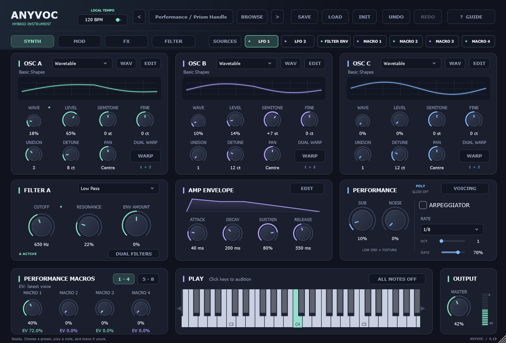

# Anyvoc

面向 Windows 的原创波表、采样与颗粒合成器，提供 **独立程序和 VST3 乐器插件**。当前版本 **0.19.0** 新增八个宏作为调制目标、独立的实时有效值显示及两个示例音色；本机 201 组自动测试、声音回归和发行包校验通过。项目优先完善独立版的调音体验。

项目以 Serum 2 的功能与操作体验为长期参考，目前仍在开发中。**尚未实现完整功能或声音一致性，不支持 Serum 预设，也不包含 Xfer 的代码、素材或品牌界面。**



| 想了解什么 | 从这里看 |
| --- | --- |
| 目前做到哪、哪些已经验证 | [项目现状](docs/STATUS.md) |
| 下一步做什么、每阶段怎样算完成 | [开发路线](docs/ROADMAP.md) |
| 如何测试、验收、记录失败 | [测试与验收](docs/TESTING.md) |
| 从 GitHub 克隆、编译、运行、打包 | [构建与贡献](docs/BUILDING.md) |
| 小白如何发声和调音 | [三步开始](docs/快速开始.txt) · [完整使用手册](docs/USER_GUIDE.md) |
| 版本验证结果和原始日志 | [验证报告](docs/VALIDATION.md) · [0.18 归档](docs/VALIDATION-0.18.md) · [0.17 归档](docs/VALIDATION-0.17.md) |

当前能力包括 3 个振荡器、双滤波器、双层 Warp 与 FM/PM/AM/RM、4 个可绘制包络、10 个 LFO、32 行调制矩阵、8 个宏、4 类效果、琶音器和 28 个工厂音色。LFO 支持自绘曲线、相位、方向、Swing 和 20–1000 Hz 高速模式；0.17 新增 Lorenz／Rössler 连续混沌与实际引擎轨迹显示。Chaos 的 Rate 表示演化速度，Phase／Direction 在该模式下不适用。

**0.19 的宏目标：**将 LFO 或包络拖到下方宏旋钮，再用这个宏控制多个参数；也可在矩阵选择 Macro 1–8。旋钮编辑保存的基础值，EV 显示最新活动声部实际使用的值。支持两组宏、外圈深度、主来源/AUX 和一采样反馈。原 1,192 个宿主参数保留，末尾追加 64 个，共 1,256；状态为 schema 14。计算、兼容及限制见[宏目标说明](docs/MACRO_TARGETS.md)。

**当前验证：**完整四套 **201 组（75/110/10/6）**通过；最终界面文字修复后 Processor 110 组补测与 pluginval strictness 5 再次通过。旧 15 秒演示与留存 0.18 程序重渲染结果逐字节一致，新 20 秒四段宏演示通过独立分析。原生检查覆盖两组宏拖放、base/EV、外圈撤销、最小窗口，以及宏音色 SAVE→INIT→LOAD 后恢复路由和演奏电平；该原生会话发生在最后两处文字修正之前。测试范围、包校验和限制见[验证报告](docs/VALIDATION.md)。

**历史交付：**0.18 的 LFO 绘图工具／`.anycurve` 已交付，[对应云端构建及 188 组测试](docs/GITHUB_CI-0.18.md)通过，原发行包保留原哈希。0.17 的 Chaos 实现及其[175 组云端测试](docs/GITHUB_CI-0.17.md)也保留独立记录。旧版 CI 不替代 0.19 的实际运行。

**仍待完成：**更多调制目标、音频侧整组路由发布、独立路由复制、多采样/SFZ、频谱振荡器、效果总线、Clip、MPE 和其他平台。当前未实测外接 MIDI、真人听音、系统剪贴板或 DAW 工作流；宏音色载入检查不等于所有外部素材和程序重启恢复均已验证。

## 运行与构建

本机 0.19 发行包已生成并核验，入口为 `dist/Anyvoc-0.19.0-Windows/Anyvoc.exe`。使用 Windows 发布 ZIP 时，先完整解压再运行 `Anyvoc.exe`。Windows 包有 246 个文件，完整对应源码包有 4,638 个文件；最终大小和 SHA-256 记录于包外的 `dist/Anyvoc-0.19.0-PackageVerification.json`。Git 仓库保存源码、文档、截图和测试记录，**不提交 EXE、VST3、WAV 或历史发布 ZIP**；尚未上传 GitHub Release 附件，GitHub 的 “Download ZIP” 是源码包。从源码构建的步骤见构建指南，0.18 及更早的历史包保留。

在安装 Visual Studio 2022 C++ Build Tools、Windows SDK、CMake ≥ 3.22 和 Git 后，使用 PowerShell：

```powershell
git clone --recurse-submodules https://github.com/Bad0RANG3/Anyvoc.git
cd Anyvoc
powershell -NoProfile -ExecutionPolicy Bypass -File scripts/build.ps1
```

生成的独立版：`build/Anyvoc_artefacts/Release/Standalone/Anyvoc.exe`。VST3：`build/Anyvoc_artefacts/Release/VST3/Anyvoc.vst3`，它是整个插件目录。

JUCE 固定为 8.0.12 的 commit `29396c22c93392d6738e021b83196283d6e4d850`。GitHub Actions 配置为 Windows 2022 上构建和运行四套自动测试；**具体提交是否通过以 Actions 的实际结果为准**。它不会替代 pluginval、本机音频设备和 DAW 测试。

## 开发约定与许可

保持旧参数 ID、顺序、选项和默认值；新参数追加并提供状态迁移。改动需要相应的音频、状态或 UI 验证，已知问题不能通过删除断言或放宽容差掩盖。详见[构建与贡献](docs/BUILDING.md)和[测试与验收](docs/TESTING.md)。

原创代码采用 [AGPL-3.0](LICENSE)，依赖及分发要求见 [THIRD_PARTY_NOTICES.md](THIRD_PARTY_NOTICES.md)。本项目独立于 Xfer Records。
