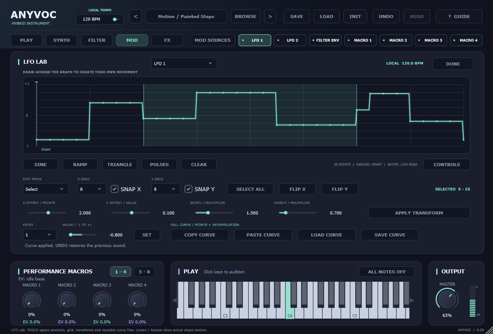

# Anyvoc

面向 Windows 的原创波表、采样与颗粒合成器，提供 **独立程序和 VST3 乐器插件**。当前版本为 **0.18.0**：LFO 绘图工具已完成实现、本轮验证及 Windows／完整源码包校验，**P1B 当前约定范围已交付，本地包可用**。[0.18 云端干净构建与 188 组测试](docs/GITHUB_CI-0.18.md)已通过；项目优先完善独立版的调音体验。

项目以 Serum 2 的功能与操作体验为长期参考，目前仍在开发中。**尚未实现完整功能或声音一致性，不支持 Serum 预设，也不包含 Xfer 的代码、素材或品牌界面。**



| 想了解什么 | 从这里看 |
| --- | --- |
| 目前做到哪、哪些已经验证 | [项目现状](docs/STATUS.md) |
| 下一步做什么、每阶段怎样算完成 | [开发路线](docs/ROADMAP.md) |
| 如何测试、验收、记录失败 | [测试与验收](docs/TESTING.md) |
| 从 GitHub 克隆、编译、运行、打包 | [构建与贡献](docs/BUILDING.md) |
| 小白如何发声和调音 | [三步开始](docs/快速开始.txt) · [完整使用手册](docs/USER_GUIDE.md) |
| 版本验证结果和原始日志 | [验证报告](docs/VALIDATION.md) · [0.17 归档](docs/VALIDATION-0.17.md) · [0.16 归档](docs/VALIDATION-0.16.md) |

当前能力包括 3 个振荡器、双滤波器、双层 Warp 与 FM/PM/AM/RM、4 个可绘制包络、10 个 LFO、32 行调制矩阵、8 个宏、4 类效果、琶音器和 26 个工厂音色。LFO 支持自绘曲线、相位、方向、Swing 和 20–1000 Hz 高速模式；0.17 新增 Lorenz／Rössler 连续混沌与实际引擎轨迹显示。Chaos 的 Rate 表示演化速度，Phase／Direction 在该模式下不适用。

0.18 的 **TOOLS** 增加独立 X/Y 网格与吸附、选区、翻转、位移与缩放、单点输入，以及跨 LFO／实例复制粘贴和 `.anycurve` 曲线文件。它保留 33 点、0.01 点值精度、1,192 个参数、schema 13 与生产 DSP。粘贴／载入明确选择 Custom；无变化的普通编辑不增加撤销记录。操作说明见[使用手册](docs/USER_GUIDE.md)。

**0.18 验证范围：**本机四套共 **188 组（68／104／10／6）**自动测试通过，VST3 通过 pluginval strictness 5。旧演示与留存 0.17 程序重渲染结果逐字节一致，Motion／Chaos 演示也保持一致；生成 84 张预览，新增 4 张逐一检查无裁切。原生检查覆盖曲线文件保存／载入、选区翻转与撤销、Custom 切换、屏幕 C4 输出表、取消文件选择及最小窗口。Windows 包 208 个文件、完整源码包 4,600 个文件的版本与逐文件内容校验通过。[源码提交 45578ca 的云端构建与四套测试](docs/GITHUB_CI-0.18.md)也已通过，共 188 组、零失败、约 130.98 秒。云端证据为发布后补充，既有 0.18 包保留原文档快照与哈希。具体证据见[验证报告](docs/VALIDATION.md)。

**0.17 历史证据：**四套共 175 组测试、本机 pluginval、音频对比、原生操作及发行包核验已完成；[提交 f20c1aa 的云端干净构建及 175 组测试](docs/GITHUB_CI-0.17.md)也已通过。这些云端结果仅对应 0.17。

**尚未验证/完成：**本轮未实测操作系统剪贴板、外接 MIDI、真人听音、整音色原生保存重开或 DAW 工作流；FL Studio 和其他 DAW 仍需分别验收。macOS、AU、AAX 尚未提供。宏作为调制目标、多重采样/SFZ、频谱振荡器、效果总线、Clip 编曲、MPE 等仍在路线图。

## 运行与构建

本地 0.18 独立版入口为 `dist/Anyvoc-0.18.0-Windows/Anyvoc.exe`；若使用 Windows 发布 ZIP，先完整解压再运行 `Anyvoc.exe`。Git 仓库保存源码、文档、截图和测试记录，**不提交 EXE、VST3、WAV 或历史发布 ZIP**；GitHub 的 “Download ZIP” 是源码包。从源码构建的步骤见构建指南，0.17 及更早的历史包保留。

在安装 Visual Studio 2022 C++ Build Tools、Windows SDK、CMake ≥ 3.22 和 Git 后，使用 PowerShell：

```powershell
git clone --recurse-submodules https://github.com/Bad0RANG3/Anyvoc.git
cd Anyvoc
powershell -NoProfile -ExecutionPolicy Bypass -File scripts/build.ps1
```

生成的独立版：`build/Anyvoc_artefacts/Release/Standalone/Anyvoc.exe`。VST3：`build/Anyvoc_artefacts/Release/VST3/Anyvoc.vst3`，它是整个插件目录。

JUCE 固定为 8.0.12 的 commit `29396c22c93392d6738e021b83196283d6e4d850`。GitHub Actions 配置为 Windows 2022 上构建和运行四套自动测试；**具体提交是否通过以 Actions 的实际结果为准**。它不会替代 pluginval、本机音频设备和 DAW 测试。

## 开发约定与许可

保持旧参数 ID、顺序、选项和默认值；新参数追加并提供状态迁移。改动需要相应的音频、状态或 UI 验证，已知问题不能通过删除断言或放宽容差掩盖。详见[构建与贡献](docs/BUILDING.md)和[测试与验收](docs/TESTING.md)。

原创代码采用 [AGPL-3.0](LICENSE)，依赖及分发要求见 [THIRD_PARTY_NOTICES.md](THIRD_PARTY_NOTICES.md)。本项目独立于 Xfer Records。
